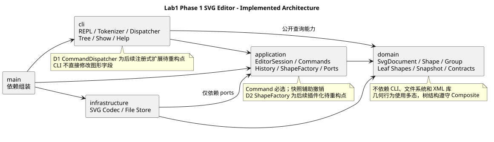

# Lab1 Phase 1：SVG 编辑器（CLI）

仓库：[Tastezz/svg-editor](https://github.com/Tastezz/svg-editor)（当前私有）。

状态：**实现与自主验收完成，待学生复核、确认教师访问和最终提交；尚无 final 标签。**

作业原文：[phase_cli_1.md](requirements/phase_cli_1.md)。学生后续工作见 [STUDENT_HANDOFF.md](STUDENT_HANDOFF.md)，实际检查见 [VALIDATION.md](VALIDATION.md)。

## 架构方案

### 1. 模块划分与职责

图形模型不依赖终端、文件系统或 XML 库。命令组织编辑行为，外部适配器负责读写。main 只组装依赖。

```text
src/
  domain/
    model/          Shape、五种叶子、Group、SvgDocument、快照与值对象
    contracts/      只读图形输出描述
  application/
    commands/       编辑命令：一类一文件
    history/        历史分支、撤销重做与 I/O 屏障
    factories/      唯一图形类型构造入口
    ports/          文件/编码/图形读取接口和输入契约
    EditorSession.ts
  cli/              Tokenizer、分发、REPL、tree/show
  infrastructure/
    svg/            XML 与 SVG 数字/变换语法适配
    fs/             原子文件读写
  main.ts
tests/              domain、application、cli、integration、fixtures、support
examples/           作业会话脚本和 SVG
scripts/            检查与演示等开发工具
```

| 模块 | 职责及实际入口 |
| --- | --- |
| domain | [Shape](../src/domain/model/Shape.ts) 封装公共行为；[Group](../src/domain/model/Group.ts) 管子节点；[SvgDocument](../src/domain/model/SvgDocument.ts) 管画布、树与 id 索引；[DocumentSnapshot](../src/domain/model/DocumentSnapshot.ts) 深拷贝恢复 |
| application | [EditCommand](../src/application/commands/EditCommand.ts) 包装事务；[CommandHistory](../src/application/history/CommandHistory.ts) 管历史；[EditorSession](../src/application/EditorSession.ts) 协调用例与文档路径；[ShapeFactory](../src/application/factories/ShapeFactory.ts) 创建图形 |
| cli | [CommandDispatcher](../src/cli/CommandDispatcher.ts) 解析命令入口；Tokenizer 处理引号；REPL 逐行执行；TreeRenderer/ShowRenderer 排版，不实现图形算法 |
| infrastructure | [SvgCodec](../src/infrastructure/svg/SvgCodec.ts) 经端口构造/读取模型；[FileDocumentStore](../src/infrastructure/fs/FileDocumentStore.ts) 处理文件与替换 |
| main | 创建具体工厂和适配器，注入 Session 与 REPL |

PlantUML 组件图（[源文件](architecture.puml)）：



### 2. 设计模式如何落地

**Command 是编辑入口。** create/delete/move/scale/set/group/ungroup/addto/front/back 各有一个命令类。基类在副本文档上执行具体操作，通过验证后才提交结果；历史只在成功后入栈。一次 group 涉及多个节点，仍只有一个命令对象和一个撤销单元。

**Composite 统一图形和容器。** Rect/Circle/Ellipse/Line/Text 与 Group 共享 Shape 接口，几何操作由对象多态完成。Group 用自身矩阵整体移动；缩放递归处理后代的几何与矩阵平移量。公共样式保存在相应元素上，不把组的 fill 强行写进每个子图形。

**Memento 辅助精确撤销。** 每条成功命令保存前后模型深拷贝，undo/redo 恢复类实例、父链、id 索引和顺序。没有用 JSON 丢掉原型，也没有用反向浮点运算猜原值。代价是每条历史 O(n) 内存，适合本阶段的小文档，未来大图可改差量历史。

**工厂与适配器隔离变化。** CLI create 和 SVG 导入复用同一图形工厂。SvgCodec 只依赖 ShapeReader 端口，不导入具体工厂；文件系统也通过端口注入。序列化消费对象产生的只读描述，不再复制一份 switch(tag)。这些描述是传输契约，真正可编辑的模型仍由封装字段与行为的类构成。

仅保留两处命令/图形名称分派，并明确登记后续重构：

| 位置 | 当前实现 | 后续待重构 |
| --- | --- | --- |
| D1 CommandDispatcher | 命令名到入口的内置注册表 | 从命令提供者收集定义 |
| D2 ShapeFactory | 六种类型的内置构造与导入 schema | 改为 ShapeProvider 提供能力 |

本阶段未实现动态插件或 box。SVG 数字、变换、引号属于语法解析，不承担图形类型分派。

### 3. 依赖方向规则

| 发起模块 | 可以依赖 | 原因 |
| --- | --- | --- |
| domain | domain 与语言标准能力 | 模型不受交互和存储影响 |
| application | application、domain | 组织用例，对外部能力只声明端口 |
| cli | cli、application、domain 公开查询、终端标准库 | 负责交互，不能访问具体 fs/XML 适配器 |
| infrastructure | infrastructure、application/ports、domain、外部库 | 外部实现朝内核接口适配 |
| main | 各模块公开入口 | 唯一组装位置 |

禁止领域层反向依赖外层，禁止 application 导入 cli/infrastructure，禁止 cli 直接操作文件；不允许运行时循环依赖。Composite 中父子类型的相互引用不产生运行时循环。

`npm run check:architecture` 检查当前静态导入、ports 边界、运行时循环、类文件名及 tag/type switch。另外逐段阅读实际职责，避免只靠“检查变绿”判断架构。

### 4. 变化点假设

| 可能的变化 | 已留出的部分 | 暂不实现的部分及原因 |
| --- | --- | --- |
| 新增图形/box | Shape 多态、唯一工厂、统一容器语义 | 插件加载和提供者发现不属于 Phase 1 |
| 新交互入口 | Command/Session 不依赖终端 | 没有 GUI 或 agent 服务需求 |
| 换存储或文件编码 | DocumentStore/DocumentCodec/ShapeReader 端口 | 不加数据库与云存储 |
| 图形/历史变大 | 快照封装在命令和模型之间 | 小文档优先保证恢复正确，暂不做差量历史 |
| 外部 SVG 更复杂 | XML/变换语法集中在适配器 | 不声称实现完整 SVG 标准，未知内容明确失败 |

### 5. 已确定的实现语义与边界

- id 全局唯一、区分大小写；导入补号前先收集全文件显式 id。
- 失败编辑、失败读取/保存不改文档、路径、历史和 I/O 屏障；保存先写同目录临时文件再替换。
- 成功 init/read/save/canvas 修改清空并锁住历史；查询与失败命令不影响历史，下一条成功编辑才解禁。
- 保留变换矩阵；换父级时用相对矩阵补偿，不能默默丢掉 transform。
- 默认样式保持省略；文本是子文本；XML 字符和 CR 的往返另有校验。
- front/back 仅调整同级顺序，front 对应后绘制的末尾。

跨父级 group、init/canvas 单参数、默认保存路径及无文档 help 的暂定解释见 [DECISIONS.md](DECISIONS.md)。它们已实现并测试，仍保留学生向课程核实的事项。支持范围和限制见 [COMPATIBILITY.md](COMPATIBILITY.md)。

## 过程记录

以下是实际开发中发生的判断和纠正，不能当成学生本人已经做过的工作。

| 阶段 | 问题或讨论 | 如何确认与处理 |
| --- | --- | --- |
| 需求 | box 虽有完整示例，但明确是后续阶段 | 从本阶段排除，create box 保持 unknown shape type |
| 工具链 | 需要保证本地可复现，避免依赖全局 TypeScript | 使用已有 Node 24、项目依赖与锁文件，先编译后运行 |
| SVG 变换 | 直接把 transform 烘焙进坐标还会涉及字形、描边与样式继承 | 先做矩阵/XML 实验，选择保留矩阵；浏览器对照样例验证 |
| 图形树 | 仅改变父引用会使图形在带变换的容器中跳位 | 加相对矩阵补偿，测试跨父级 group/addto/ungroup；共享奇异祖先也不必求世界逆矩阵 |
| 原子性 | 只预检参数无法覆盖递归过程中途溢出 | Command 在副本中执行；溢出测试确认原文档与历史完全不变 |
| 依赖自查 | SvgCodec 最初直接依赖具体 ShapeFactory，违反 ports 规则 | 抽出 ShapeReader 与中立输入契约，自动和人工复查依赖 |
| XML 边界 | XML 库默认接受 NUL，库自身 round-trip 成功不代表浏览器可读 | 依据 XML 1.0 补字符校验、严格序列化和 CR 引用，加入回归测试 |
| 终端试用 | undo 状态已恢复，反馈却还显示旧操作后的坐标 | 改为显示恢复后的属性、父级和索引，并补断言 |
| 完整验收 | 单测不足以证明用户入口可用 | 真实进程回放两段作业会话，真实文件读写，实际 PTY、浏览器及独立检出复现 |

以上步骤有分步 Git 提交，未把成品一次性提交。远程同步由本机 GitHub CLI 完成，仓库级配置未修改其他项目的 Git 身份。

## 一致性自查

**模块划分是否一致？** 生产代码按 domain/application/cli/infrastructure/main 落地。相对初始草案，增加了 `tests/cli` 与 `tests/support` 以放分词/REPL 测试和端口替身；增加 scripts 放开发检查工具。ShapeInput 最初放在 factories，依赖复核后移到 ports。这些修订已记录。

**依赖方向是否违反？** 当前 43 个源文件检查通过。抽样看 CreateCommand 只调用模型/工厂；Shape/Group 不依赖终端和 XML DOM；SvgCodec 只导入 application/ports；具体对象都在 main 组装。当前未发现违反已声明方向的依赖。

检查脚本覆盖静态导入与结构规则，不能自动证明所有设计合理；还另外检查了两处分派及类职责。文件中可编辑实体是有行为的类，传输接口不承担领域操作。

## 质量保证手段

实际验证记录见 [VALIDATION.md](VALIDATION.md)，逐项证据见 [ACCEPTANCE.md](ACCEPTANCE.md)。

1. **55 项自动测试**覆盖六种图形、树结构、全部编辑的撤销粒度、失败原子性、redo 分支、I/O 屏障、错误措辞与文件往返。
2. **180 次确定性混合编辑**逐步验证不变量与 SVG 往返，再完整 undo/redo，补充单条命令用例。
3. **真实 CLI 与文件系统**回放作业第 6 节和 6.1 节版本 A；文件失败场景检查原文件、当前文档和历史。
4. **浏览器可见效果**检查流程图、容器移动、嵌套变换前后和本地渲染的 PlantUML 图。
5. **独立干净检出**运行安装、类型检查、架构检查、测试和 demo；生成示例与提交的 SVG 一致，检出工作区仍干净。

这说明当前实现具有可复现的 Phase 1 功能依据，不代表支持任意 SVG。学生验收、教师访问、截止时间和 final 标签尚待完成。

### 复现命令

```sh
npm ci
npm run typecheck
npm run check:architecture
npm test
npm run demo
npm run cli
```

架构图由本地 PlantUML 1.2026.9 渲染，已提交 SVG。核心编辑器只依赖 Node；重新渲染图时可设置本地 `PLANTUML_JAR`、`JAVA_BIN` 后运行 `npm run render:architecture`，不需要上传源码。

技术依据：[TypeScript strict](https://www.typescriptlang.org/tsconfig/strict.html)、[Node 24 测试运行器](https://nodejs.org/docs/latest-v24.x/api/test.html)、[xmldom](https://github.com/xmldom/xmldom)、[XML 1.0 字符规则](https://www.w3.org/TR/xml/#charsets)。
