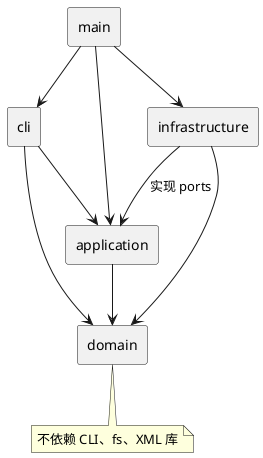

# Lab1 Phase 1：SVG 编辑器（CLI）

仓库地址：[https://github.com/Tastezz/svg-editor](https://github.com/Tastezz/svg-editor)（当前为私有仓库）。

状态：**M1 工具链与 XML/矩阵实验已完成；图形编辑仍在开发，不是最终提交版。**

本方案依据 [作业原文](requirements/phase_cli_1.md)。具体开发步骤见 [PLAN.md](PLAN.md)，验收项目见 [ACCEPTANCE.md](ACCEPTANCE.md)。

## 架构方案

### 1. 模块划分

先把图形操作做成不依赖终端、文件系统的内核，再接入 CLI 和 SVG 文件。这样同一组编辑行为以后也能由其他交互入口调用。

下列目录是**计划结构**，实现时按阶段建立，不用空类和空目录假装完成。

```text
src/
  main.ts                     # 组装依赖、启动程序
  domain/
    model/                    # 文档、图形、容器、唯一 id 与树结构规则
    contracts/                # 图形输出协议等与具体 IO 无关的接口
  application/
    commands/                 # 一种编辑命令一个类
    history/                  # 撤销、重做、I/O 屏障
    factories/                # 唯一的图形类型分派入口
    ports/                    # 存储与文档编码接口
    EditorSession.ts          # 当前文档、读入路径与用例协调
  cli/                        # 分词、命令分发、REPL、tree/show/help 格式
  infrastructure/
    svg/                      # XML 解析、模型转换、SVG 序列化
    fs/                       # 文件读写及安全替换
tests/
  domain/
  application/
  integration/
  fixtures/                   # 外部 SVG、坏文件、脚本输入和预期输出
examples/                     # 最小示例与两节点流程图
doc/
```

| 模块 | 主要对象与职责 | 明确不做的事 |
| --- | --- | --- |
| domain | `SvgDocument` 管树、画布和 id 索引；`Shape` 定义统一行为；`Rect` 等叶子类与 `Group` 封装几何属性及操作；`DocumentSnapshot` 封装深拷贝与恢复 | 读文件、打印终端、理解命令字符串或 XML DOM |
| application | `CreateCommand`、`MoveCommand` 等表达一次编辑；`CommandHistory` 管历史；`EditorSession` 协调编辑、查询和文档 I/O；`ShapeFactory` 构造图形 | 直接调用 fs/readline，处理 XML 库对象 |
| cli | `Tokenizer` 保留引号和参数边界；`CommandDispatcher` 解析并调用用例；REPL 处理逐行输入；显示类负责排版 | 绕过模型修改字段、自己实现图形算法 |
| infrastructure | `SvgCodec` 把 XML 与模型互转；`FileDocumentStore` 实现文件端口 | 决定 undo 策略、处理 CLI 参数 |
| main | 创建具体对象并注入依赖 | 放业务规则 |

组件图源文件：[architecture.puml](architecture.puml)。



### 2. 设计模式的选择与计划落地

**Command（必选）**：每种编辑命令对应一个类。基类 `EditCommand` 统一提供 execute / undo / redo 的生命周期，具体子类只实现本次编辑的模型操作。命令对象接收已解析参数，不接触原始输入行。`CommandHistory` 只负责执行成功后的入栈、出栈与分支清理。

**Composite**：`Shape` 的子类包含五种叶子图形与 `Group`。move / scale / set / delete 通过统一的对象行为完成；`Group` 用自身变换整体平移，scale 递归缩放几何和变换平移分量，每个后代恰好处理一次。容器的 fill 等公共样式保存在容器上，交给 SVG 继承，不强行改写所有子节点的显式样式。不能把模型做成公共字段数据袋，再到各处按 tag 分支。

**Memento（辅助 Command）**：Phase 1 数据规模小，先保存每条成功编辑前后的内存深拷贝，undo/redo 精确恢复，而不是用反向浮点运算猜原值。快照由模型负责生成和恢复，恢复时重建父子关系与 id 索引；不能用 JSON 序列化把类原型丢掉。代价是每条历史占 O(n) 内存，暂不实现差量历史。

**工厂与适配器**：图形创建与 SVG 导入复用同一个 `ShapeFactory` 类型注册表；XML 库和文件系统被适配器隔离。导入先把 DOM 转成中立的输入描述，再交工厂构造领域对象。写出与显示使用图形多态方法或领域层定义的输出协议，不增加新的 `switch(tag)`。

作业仅允许的两处按名称分派，明确登记为后续待重构点：

| 编号 | 位置 | Phase 1 做法 | 后续待重构方向 |
| --- | --- | --- | --- |
| D1 | `CommandDispatcher` | 命令名到命令解析/构造入口的内置映射 | 从命令提供者收集注册项 |
| D2 | `ShapeFactory` | 六种类型到构造入口的内置映射；CLI create 和 SVG 导入共用 | 从 ShapeProvider 收集创建、导入等能力 |

这两处之外，禁止在移动、缩放、显示和序列化中复制类型分派逻辑。本阶段不实现动态插件加载，也不实现 `box`。

### 3. 依赖方向规则

| 发起模块 | 可以依赖 | 理由 |
| --- | --- | --- |
| domain | domain、语言标准能力 | 图形规则不受入口和存储方式影响 |
| application | application、domain | 组织用例与历史；对外部能力只声明端口 |
| cli | cli、application、domain 的公开查询能力、终端标准库 | 负责交互，不承担文件持久化 |
| infrastructure | infrastructure、application/ports、domain、fs/XML 库 | 外部实现朝内核接口适配 |
| main | 上述模块的公开入口 | 作为唯一的依赖组装位置 |

禁止 domain 反向导入 application/cli/infrastructure；禁止 application 导入 cli/infrastructure；禁止 cli 直接引用具体文件或 XML 适配器。跨模块不访问 private 字段，不引入循环依赖。实现后用导入关系检查，并人工抽查工厂、命令、SVG 编解码三个位置。

### 4. 变化点假设

| 可能的变化 | 本阶段预留 | 暂不做什么及原因 |
| --- | --- | --- |
| 新增图形或 `box` | 图形多态、单一工厂、容器统一行为 | 不做插件发现与动态加载，本阶段不评分 |
| CLI 之外的入口 | 编辑命令与模型不依赖终端 | 不做 GUI/agent 服务，先验证内核可复用 |
| 文件格式或存储变化 | `DocumentStore` / `DocumentCodec` 端口 | 不加数据库与云存储，没有实际需求 |
| 图形数量和历史变大 | 用快照对象封装恢复机制 | 暂不实现差量撤销，先保证复杂树操作正确 |
| 外部 SVG 兼容范围扩大 | XML 转换集中在 svg 适配器 | 不声称支持完整 SVG 标准；未支持结构须明确报错，不能悄悄丢内容 |

### 5. 容易出错的语义

1. **失败原子性**：在文档副本上完整验证并编辑，成功后才替换当前文档和写入历史。失败不得改变图形树、id、路径、undo/redo 或屏障状态。read 先完整解析后替换；save 先写同目录临时文件再替换目标，失败清理临时文件。
2. **I/O 屏障**：成功 init/read/save/canvas 修改尺寸后清空两栈并锁住撤销重做，报原文规定的错误；下一条成功编辑才重新解禁。canvas 查询与 tree/show/help 不改变历史，失败命令也不解禁。
3. **树结构**：id 全局唯一且大小写敏感；父子关系双向一致；不能把容器放入自身或后代；删除子树必须同步移除全部 id；undo 必须恢复原父级和原顺序。
4. **几何操作**：坐标可为负、可为浮点，数字必须有限；scale 必须大于 0，并同时缩放位置和尺寸。只缩放作业规定的几何属性，不自行缩放 stroke-width。容器不能被重复递归缩放。
5. **z-order**：SVG 按兄弟顺序绘制；front 移至兄弟列表末尾，back 移至开头，只改同级顺序。
6. **读写**：保留层级、顺序、文本内容及受支持属性；缺省 fill/stroke 不补写黑色/none。自动补 id 前先收集所有显式 id，避免与文件后部已有 id 冲突；每次补号打印原文格式的 warning。显式 id 重复则整次读取失败。
7. **分词**：只把去除前导空白后以 `#` 开始的整行当注释，不能把 `#4a90d9` 当行内注释；保留带空格文本、空字符串和引号状态，尾缀 `in` 必须在引号外识别。

### 6. 原文未完全明确的部分

以下是**暂定解释**，实现前先补成小用例，并在对应阶段核实；不把这些解释写成老师已明确要求。

| 问题 | 当前处理计划 |
| --- | --- |
| group 跨父级时新容器放哪里、相对顺序如何定义 | 同父级按原兄弟顺序收入，容器放最早被选位置；跨父级暂按最近公共祖先放置，子节点按原树遍历顺序收入。该规则需在 M2 前核实并记入修订记录 |
| 示例中出现 transform，但未规定导入后的编辑方式 | M1 已选择保留矩阵；矩阵顺序、求逆与重分组补偿通过单元测试，M2/M5 继续验证模型与文件往返。详见 DECISIONS.md |
| `init [w] [h]` / `canvas [w] [h]` 的单参数情况 | 确保零参数与双参数先符合原文；单参数行为在写解析器时单独确认 |
| 未创建文档时能否 help | 暂定 help 可用；其他依赖文档的操作报 no document，便于首次启动使用 |
| `save` 无参数的路径 | 严格先按原文使用 read 时的路径；init 后没有读入路径时要求显式文件名。显式 save 是否更新默认路径，待 M5 核实 |
| 未支持的 SVG 元素、属性、复杂文本与变换 | 先界定兼容范围；不支持且无法无损保留时整次拒绝，不能输出看似成功但已丢内容的文档 |
| set 的尺寸边界和空历史报错文本 | 暂定尺寸/半径/stroke-width 不为负，画布尺寸为正；空栈错误统一以 error: 开头。原文未指定的完整措辞另行固定 |

## 过程记录

只记录实际发生的讨论、纠正与验证，不预先编造开发经历。

| 日期 | 实际发生的工作或判断 | 结果/后续验证 |
| --- | --- | --- |
| 2026-10-26 | 阅读 Phase 1 作业，发现 `box` 虽有完整示例，但明确属于后续阶段 | 从当前范围排除 box 和动态插件，保留工厂变化点 |
| 2026-10-26 | 提取容易漏掉的约束：失败不改状态、I/O 后禁撤销、顶层容器禁解组、仅两处名称分派 | 纳入架构与验收清单，尚未通过代码验证 |
| 2026-10-26 | 对照需求发现跨父级 group、transform 和默认保存路径存在解释空间 | 建立暂定解释与阶段检查点，尚未认定为最终语义 |
| 2026-10-26 | 检查本机 Node/npm/Git，编写规划 | 固定已有 Node 版本；未安装依赖、未改动全局配置 |
| 2026-10-26 | 创建 GitHub 私有仓库并关联 origin，配置本仓库的 GitHub noreply 提交身份 | 远程地址已填入文档；身份配置未影响其他项目 |
| 2026-10-26 | 安装官方 GitHub CLI，在用户确认后完成首次授权；排查出命令行未沿用系统代理导致的超时 | 在仓库级配置 Git 的代理与凭据助手；未额外授予 Workflow 权限 |
| 2026-10-26 | 比较把 transform 烘焙进坐标与保留矩阵两种方案，发现前者还要处理文字字号、描边和嵌套，容易丢失外观 | 采用保留矩阵；5 项 XML/矩阵实验通过，尚待模型与浏览器验收 |

后续每条记录应写清：AI/人工提出的建议 → 发现的问题 → 如何确认 → 实际修改 → 用例或提交证据。

## 一致性自查

目前只有工具链、Transform 值对象和小实验，不能据此宣称完整架构已经落实。

| 问题 | 当前结论 | 完成时应补的证据 |
| --- | --- | --- |
| 实际目录与模块方案一致吗？ | 已建立 src/domain/model 与 tests，其余随实现展开 | 目录对照、差异说明及修订记录 |
| 依赖规则被违反了吗？ | 当前 Transform 不依赖外层；完整检查待实现 | 导入检查结果，命令/工厂/编解码抽查路径 |
| 一类一文件、封装与多态落地了吗？ | 待检查 | 代表类路径，禁止分派的检查结果 |

## 质量保证手段

完整清单见 [ACCEPTANCE.md](ACCEPTANCE.md)。以下是计划，不是已通过的测试结果。

1. 领域测试：图形运算、树结构、全局 id、父子关系和顺序。
2. 用例测试：每条编辑都是一个 undo 单元；失败保持状态；I/O 屏障和 redo 分支符合要求。
3. CLI 集成测试：真实 stdin/stdout 回放作业第 6 节、第 6.1 节版本 A；检查前缀、警告、文本和颜色解析。
4. 文件测试：导入缺 id/重复 id/坏 XML；save → read 后比较模型语义；使用临时目录验证读写失败。
5. 人工预览：浏览器检查生成的最小图与流程图，尤其关注嵌套、文本、颜色和前后层级。
6. 架构检查：严格类型检查、模块依赖、一类一文件及两处分派限制。
7. 最后从干净检出执行安装、构建、测试和示例，补上真实命令结果，再创建 `final`。

当前验证状态：**npm run typecheck、npm test 通过（5 项 XML/矩阵测试）；编辑器功能与 SVG 浏览器预览尚待验证。GitHub 仓库已关联并完成首次同步。**

## 技术参考

- [TypeScript strict 配置](https://www.typescriptlang.org/tsconfig/strict.html)：计划启用严格类型检查。
- [Node.js 24 测试运行器](https://nodejs.org/docs/latest-v24.x/api/test.html)：计划用 node:test 与 node:assert/strict。
- [npm package-lock.json](https://docs.npmjs.com/cli/v11/configuring-npm/package-lock-json/)：提交锁文件以记录依赖树。
- [xmldom 官方仓库](https://github.com/xmldom/xmldom)：XML DOM 解析与序列化候选；M1 做小样验证后锁定依赖版本。
